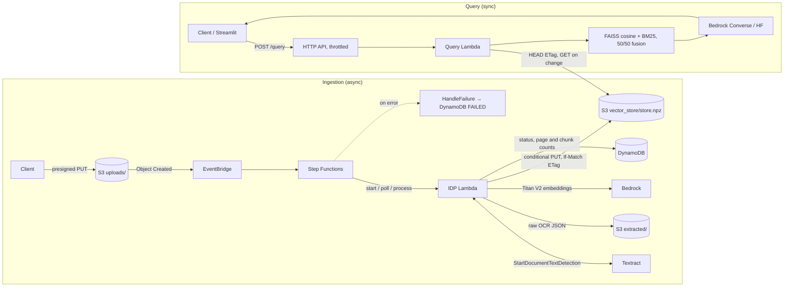

# Serverless Document Processing & Hybrid RAG on AWS

[](https://github.com/JohnnyWilson16/aws-idp-rag/actions/workflows/ci.yml)
[](https://www.python.org/)
[](template.yaml)
[](LICENSE)

Upload a PDF or scanned image. The pipeline extracts the text with OCR, indexes it, and answers questions about it with document and page citations.

- **Ingestion:** S3 → EventBridge → Step Functions → Textract async OCR (pypdf and Rekognition fallback) → page-aware chunks → embeddings → FAISS store on S3
- **Query:** API Gateway → Lambda → hybrid retrieval (FAISS cosine + BM25) → Amazon Bedrock Converse (Nova Micro) or Hugging Face → answer with `[Document, Page]` citations
- **Infrastructure:** One SAM template. Every compute part is serverless, so idle cost is close to zero.

## Architecture



## Design decisions

| Problem | Decision |
| :--- | :--- |
| A vector database costs money while idle. OpenSearch Serverless has a minimum OCU charge. | A FAISS `IndexFlatIP` is stored as **one S3 object** with its chunk metadata. The query Lambda caches it in memory and downloads it again only when the S3 ETag changes. |
| Two uploads indexed at the same time can overwrite each other's vectors. | The IDP Lambda writes the store with **S3 conditional writes** (`If-Match` / `If-None-Match`). On a conflict it reloads, re-applies its change, and retries with backoff. A unit test simulates the race. |
| Index and metadata in separate files can get out of sync. A pickle loaded from S3 can run code. | Index, metadata and manifest go into one `.npz` object, loaded with `allow_pickle=False`. |
| Vectors from different embedding models cannot be compared. | The store records an **embedding manifest** (provider, model, dimension). The indexer rejects vectors from a different model. Queries always embed with the model in the manifest. |
| Dense search misses exact tokens such as invoice numbers, amounts and IDs. | **Hybrid retrieval:** `0.5 × cosine + 0.5 × BM25 / max(BM25)`. BM25 uses an inverted index that is built once per store version. A chunk with no keyword match needs a cosine score of at least 0.5. |
| The embedding API can be down at query time. | Retrieval falls back to **BM25 only** and reports `retrieval_mode: "sparse-only"`. It does not substitute another model's vectors. |
| The LLM can be unavailable, or Bedrock model access is not enabled. | The Bedrock path tries the requested model, then Nova Micro and Nova Lite. Next it tries Hugging Face if a token is set. As a last step it returns an **extractive answer**: quoted source sentences with citations and no generated text. |
| Hallucinated answers | The prompt allows only the retrieved excerpts and requires citations. Out-of-scope questions retrieve nothing and get a fixed refusal. |
| Multi-page PDFs | Sync Textract accepts single pages only. Step Functions runs async Textract with a non-blocking `Wait`/poll loop and paginates the results with `NextToken`. |
| Operations | API Gateway throttling (10 rps, burst 20), X-Ray tracing, CloudWatch alarms on failed ingestions and query Lambda errors (optional email through SNS), and one structured JSON log line per query with timings. |

## Retrieval latency

`python scripts/bench_retrieval.py` measures in-process hybrid retrieval (FAISS search + BM25 + fusion). It excludes the embedding call and the LLM call. Results on an Apple M2 laptop:

| Chunks | Dims | p50 | p95 |
| ---: | ---: | ---: | ---: |
| 500 | 1024 | 0.17 ms | 0.20 ms |
| 5,000 | 1024 | 0.91 ms | 0.97 ms |
| 20,000 | 384 | 1.61 ms | 1.68 ms |

Lambda on ARM64 is slower than a laptop. End-to-end latency is dominated by the embedding call and the LLM call. The API returns these timings in `timings_ms`.

## Run it locally (no AWS account needed)

```bash
git clone https://github.com/JohnnyWilson16/aws-idp-rag.git
cd aws-idp-rag
python3.11 -m venv .venv && source .venv/bin/activate
pip install -r requirements-dev.txt

pytest                                                    # unit tests
python scripts/local_pipeline_runner.py --provider local  # end-to-end on samples/*.pdf, offline
```

`--provider local` uses a hashed bag-of-words embedding, so it needs no credentials. Use `--provider bedrock` (needs AWS credentials) or `--provider huggingface --hf-token ...` for real embeddings and LLM answers. The script uses the same chunking, indexing, retrieval and answer code as the Lambdas. Only OCR differs: it reads the PDF text layer with pypdf instead of calling Textract.

## Deploy

Prerequisites: AWS SAM CLI, Docker, and Bedrock model access for Titan Text Embeddings V2 and Amazon Nova Micro in your region.

```bash
sam build --use-container
sam deploy --guided \
  --stack-name aws-idp-rag \
  --capabilities CAPABILITY_IAM CAPABILITY_NAMED_IAM \
  --parameter-overrides ModelProvider=bedrock AlarmEmail=you@example.com
```

The stack outputs `ApiEndpoint`, the bucket name and the table name. To delete everything, run `./scripts/setup_aws_resources.sh delete`. It empties the bucket first.

**Upgrading an older deployment** (with `vector_store/index.faiss` + `metadata.pkl`): redeploy, then rebuild the store from the OCR output that is already in S3:

```bash
MODEL_PROVIDER=bedrock python scripts/reindex_store.py --bucket <DocumentStorageBucketName> --table <DocumentMetadataTableName>
```

## API

| Method | Path | Purpose |
| :--- | :--- | :--- |
| `POST` | `/upload-url` | `{"filename", "content_type"}` → presigned S3 PUT URL (PDF, PNG, JPEG, TIFF) |
| `GET` | `/documents` | List documents with status, pages and chunks |
| `GET` | `/documents/{id}` | One document's status |
| `POST` | `/query` | `{"question", "top_k"?, "provider"?, "model"?}` → answer + sources |

```bash
API=<ApiEndpoint>
curl -s -X POST "$API/upload-url" -H 'Content-Type: application/json' \
  -d '{"filename": "master_service_agreement.pdf", "content_type": "application/pdf"}'
curl -s -X PUT "<upload_url>" -H 'Content-Type: application/pdf' --data-binary @samples/master_service_agreement.pdf
curl -s "$API/documents"
curl -s -X POST "$API/query" -H 'Content-Type: application/json' \
  -d '{"question": "What is the aggregate liability cap?"}'
```

Response shape:

```json
{
  "question": "What is the aggregate liability cap?",
  "answer": "Aggregate liability is capped at $500,000 USD [Document: master_service_agreement.pdf, Page: 4].",
  "sources": [
    {"doc_name": "master_service_agreement.pdf", "page_number": 4, "snippet": "...",
     "relevance_score": 0.66, "dense_score": 0.32, "sparse_score": 1.0}
  ],
  "chunks_retrieved": 1,
  "model_used": "us.amazon.nova-micro-v1:0",
  "retrieval_mode": "hybrid",
  "timings_ms": {"embed_ms": 41.2, "retrieve_ms": 0.3, "generate_ms": 612.5, "total_ms": 655.1}
}
```

Streamlit UI: `API_GATEWAY_URL=<ApiEndpoint> streamlit run frontend/app.py`

CloudWatch Logs Insights, query latency by model:

```
fields @timestamp, model_used, retrieval_mode, total_ms
| filter event = "query"
| stats avg(total_ms), pct(total_ms, 95) by model_used
```

## Limitations

- **No authentication.** The API is public and protected only by throttling. Add a JWT authorizer (Cognito) before you share the URL widely.
- **Single global index.** All uploaded documents share one store. Multi-tenant use needs a store per tenant (for example `vector_store/<tenant>/store.npz`) and authorization.
- **Write throughput.** Each document rewrites the whole store object. This works well for tens of thousands of chunks. For millions, use a vector database (OpenSearch, pgvector, S3 Vectors).
- **Exact search.** `IndexFlatIP` is O(n) per query. Switch to `IndexHNSWFlat` above about 100k chunks.
- **Evaluation.** The tests check retrieval behavior on sample documents. There is no labeled retrieval benchmark (recall@k, answer faithfulness) yet.

## Project layout

```
template.yaml                    SAM: S3, DynamoDB, Step Functions, 3 Lambdas (arm64), HTTP API, alarms
src/idp_pipeline/
  handler.py                     Step Functions tasks: start, check_status, process_and_index, handle_failure
  textract_utils.py              Async Textract, block parsing, page-aware chunking
  embedding_utils.py             Bedrock Titan V2 / Hugging Face / local-hash embeddings
  faiss_indexer.py               Single-object S3 store, conditional writes, per-document replace
src/query_api/
  app.py                         Hybrid retrieval (FAISS + BM25), Bedrock/HF generation, extractive fallback
  embedding_client.py            Identical copy of embedding_utils.py (a test enforces this)
src/document_api/app.py          Presigned uploads, document status
frontend/app.py                  Streamlit UI
scripts/
  local_pipeline_runner.py       Offline end-to-end run
  bench_retrieval.py             Retrieval latency benchmark
  reindex_store.py               Rebuild or migrate the S3 store from extracted OCR
  create_test_docs.py            Generate the sample PDFs
tests/                           Chunking, Textract parsing, store concurrency, BM25, grounding
```

## License

[MIT](LICENSE)
