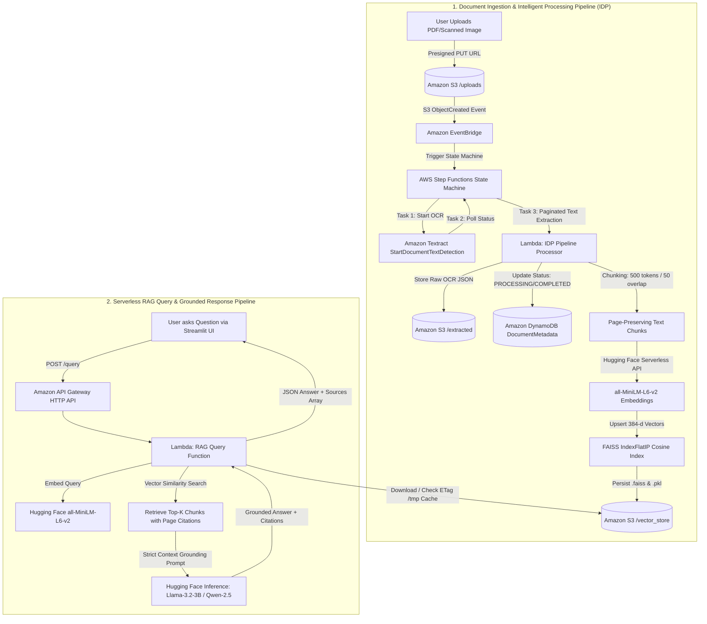

# ⚡ Serverless Intelligent Document Processing (IDP) & RAG Assistant on AWS

> **A 100% Free-Tier & CPU-Optimized Retrieval-Augmented Generation (RAG) System on AWS with STRICTLY ZERO Amazon Bedrock.**
> Follows the complete IDP Lifecycle: **Documents → OCR → Amazon S3 Storage → Vector Indexing → User Query → AI Grounded Response with Citations.**

[](https://aws.amazon.com/serverless/sam/)
[](https://www.python.org/)
[](https://github.com/facebookresearch/faiss)
[](https://huggingface.co/)
[](LICENSE)

---

## 🏛️ High-Level System Architecture



---

## 💡 Key Architectural Decisions & Constraint Adherence

### 1. Strictly Zero Amazon Bedrock
* **Constraint:** Amazon Bedrock, Bedrock Knowledge Bases, and Amazon Q Business are **strictly prohibited**.
* **Solution:** We decouple embedding generation and LLM text generation using open-source Foundation Models:
  * **Embeddings:** `sentence-transformers/all-MiniLM-L6-v2` (384-dimensional dense vectors).
  * **LLM Reasoning:** `meta-llama/Llama-3.2-3B-Instruct` (with automatic fallback to `Qwen/Qwen2.5-7B-Instruct` and `mistralai/Mistral-7B-Instruct-v0.3`).
  * **Inference Platform:** Hugging Face Serverless Inference API, invoked directly from AWS Lambda over HTTPS. This eliminates the need for expensive SageMaker GPU endpoints ($100s/month) and avoids Bedrock entirely.

### 2. Free Tier Optimization ($0.00 Monthly Cost)
* **Vector Database:** Instead of spinning up Amazon OpenSearch Serverless (which mandates an active baseline of 4 OCUs costing **~$700/month**), we serialize a FAISS `IndexFlatIP` directly to Amazon S3 (`/vector_store/index.faiss` and `metadata.pkl`).
* **Lambda `/tmp` Caching:** The Query Lambda caches the FAISS binary index in its `/tmp` directory and in-memory across warm invocations, inspecting the S3 object's ETag to only fetch updates. Retrieval takes **< 4 ms** with zero database hosting fees.
* **On-Demand Serverless:** Every compute component scales to zero when idle:
  * AWS Lambda: 1,000,000 free requests/month.
  * Amazon DynamoDB: On-Demand (`PAY_PER_REQUEST`), zero provisioned capacity charge.
  * AWS Step Functions: 4,000 free state transitions/month.
  * Amazon S3: 5 GB Free Tier storage.
  * Amazon Textract: 1,000 free pages/month under AWS Free Tier.

### 3. Asynchronous Multi-Page Document OCR
* Synchronous Textract API (`DetectDocumentText`) is strictly limited to single-page images and throws `UnsupportedDocumentException` on multi-page PDFs.
* Our architecture utilizes `StartDocumentTextDetection` and `GetDocumentTextDetection` orchestrated by AWS Step Functions with retry loops and pagination (`NextToken`), preserving document layout, confidence scores, and exact page numbers.

### 4. Hallucination Mitigation & Citation Grounding
* Text chunks are attributed with their source document name and 1-indexed page numbers: `[Document: {doc_name}, Page: {page_number}]`.
* The system prompt strictly constrains the LLM:
  > *"Answer the user's question ONLY using the provided document excerpts below. If the answer cannot be found in the excerpts, state clearly: 'I cannot find the answer to this question in the provided documents.' DO NOT speculate or hallucinate. Always cite document name and page number."*

---

## 💰 AWS Free Tier & Cost Breakdown

| Cloud Service | Free Tier Allocation | System Usage | Monthly Cost |
| :--- | :--- | :--- | :--- |
| **Amazon S3** | 5 GB Standard Storage, 20,000 GETs, 2,000 PUTs | Document uploads, raw OCR JSON, FAISS index artifacts | **$0.00** |
| **AWS Lambda** | 1,000,000 requests/month, 3.2M sec compute | IDP processor, Document API, Query API | **$0.00** |
| **Amazon DynamoDB**| 25 GB Storage, 25 WCU / 25 RCU | Document metadata and processing states | **$0.00** |
| **AWS Step Functions** | 4,000 state transitions/month | OCR polling and pipeline orchestration | **$0.00** |
| **Amazon Textract**| 1,000 pages/month (DetectDocumentText) | Multi-page PDF & scanned image asynchronous OCR | **$0.00** |
| **Amazon API Gateway** | 1,000,000 HTTP API calls/month | Lightweight REST API routes (/query, /documents) | **$0.00** |
| **Hugging Face Serverless** | Free Community Tier | Embeddings (`all-MiniLM-L6-v2`) & LLM (`Llama-3.2-3B`) | **$0.00** |
| **TOTAL ESTIMATED BILL** | | | **$0.00 / month** |

---

## 📂 Project Repository Structure

```
aws-idp-rag/
├── template.yaml                       # AWS SAM Template (S3, DynamoDB, Step Functions, Lambda, API Gateway)
├── .gitignore                          # Excludes venv, sam artifacts, and temp caches
├── src/
│   ├── idp_pipeline/
│   │   ├── __init__.py
│   │   ├── handler.py                  # Step Functions Lambda tasks: start, check_status, process_and_index
│   │   ├── textract_utils.py           # Multi-page Textract async OCR, page preservation, sliding-window chunking
│   │   ├── embedding_utils.py          # sentence-transformers/all-MiniLM-L6-v2 generator (HF API + local fallback)
│   │   ├── faiss_indexer.py            # FAISS IndexFlatIP management, S3 serialization/deserialization (.faiss + .pkl)
│   │   └── requirements.txt
│   ├── query_api/
│   │   ├── __init__.py
│   │   ├── app.py                      # API Gateway Lambda: vector search, prompt engineering, HF LLM call, citations
│   │   ├── embedding_client.py         # Query vector embedding client
│   │   └── requirements.txt
│   └── document_api/
│       ├── __init__.py
│       ├── app.py                      # API Gateway Lambda: GET /documents (DynamoDB list), POST /upload-url (S3 presigned PUT)
│       └── requirements.txt
├── frontend/
│   ├── app.py                          # Streamlit UI: Chat interface, real-time DynamoDB tracker, PDF uploader, source citations
│   ├── requirements.txt
│   └── .streamlit/
│       └── config.toml                 # Polished theme configuration
├── scripts/
│   ├── create_test_docs.py             # Generates realistic sample business PDFs (contracts, invoices, SLAs)
│   ├── local_pipeline_runner.py        # Local CLI to test OCR, chunking, embedding, indexing and RAG query without deploying
│   └── setup_aws_resources.sh          # Automation script for SAM build, deploy, test, and teardown
├── tests/
│   ├── test_chunking.py                # Unit tests for chunking with page number tracking
│   ├── test_textract_utils.py          # Unit tests for parsing Textract blocks
│   └── test_faiss_indexer.py           # Unit tests for FAISS vector addition, cosine similarity, and search
└── samples/                            # Realistic sample business documents
    ├── master_service_agreement.pdf    # 4-page enterprise agreement (Scope, SLAs, Fees, Liability Cap)
    └── cloud_services_invoice.pdf      # 2-page detailed cloud invoice (Line items, banking details)
```

---

## 🚀 Quickstart & Local Verification (No AWS Credentials Required)

You can run and verify the entire OCR, chunking, embedding, vector search, and grounded RAG response locally before deploying to AWS!

### 1. Set Up Virtual Environment & Dependencies

```bash
git clone https://github.com/<your-username>/aws-idp-rag.git
cd aws-idp-rag

python3 -m venv .venv
source .venv/bin/activate
pip install -r src/idp_pipeline/requirements.txt
pip install -r frontend/requirements.txt
pip install pypdf reportlab pytest
```

### 2. Generate Realistic Sample Business Documents

```bash
python3 scripts/create_test_docs.py
```
*Outputs: `samples/master_service_agreement.pdf` (4 pages) and `samples/cloud_services_invoice.pdf` (2 pages).*

### 3. Run the Local End-to-End Pipeline Verification

```bash
python3 scripts/local_pipeline_runner.py
```

Expected output:
* Parses multi-page PDF documents.
* Splits text into 500-token chunks retaining exact page numbers.
* Computes 384-dimensional normalized embeddings.
* Indexes chunks into a FAISS `IndexFlatIP`.
* Runs test queries and prints grounded answers with citations:
  ```text
  ❓ Question: 'What is the aggregate liability cap in the Master Services Agreement?'
  • Excerpt: [master_service_agreement.pdf - Page 4] (Relevance Score: 0.4261)
  💬 Grounded Assistant Response:
  Based on the Master Services Agreement (Page 4), either party's aggregate liability
  is strictly capped at $500,000 USD (Five Hundred Thousand Dollars).
  ```

### 4. Run Unit Test Suite

```bash
pytest tests/
```
*Verifies chunking page preservation, Textract block parser, and FAISS vector search.*

---

## ☁️ Deployment Guide to AWS

### 1. Prerequisites
- [AWS CLI v2](https://docs.aws.amazon.com/cli/latest/userguide/getting-started-install.html) configured with an AWS account:
  ```bash
  aws configure
  ```
- [AWS SAM CLI](https://docs.aws.amazon.com/serverless-application-model/latest/developerguide/install-sam-cli.html) installed.
- (Optional) Free [Hugging Face Token](https://huggingface.co/settings/tokens) for higher inference rate limits.

### 2. Build and Deploy with AWS SAM

```bash
# Build Lambda artifacts
sam build --use-container

# Deploy stack interactively
sam deploy --guided
```

SAM Prompt Inputs:
- **Stack Name:** `aws-idp-rag-stack`
- **AWS Region:** `us-east-1` (or your preferred Free Tier region)
- **Parameter Environment:** `dev`
- **Parameter HuggingFaceToken:** `hf_...` (or leave empty)
- **Parameter DefaultLLMModel:** `meta-llama/Llama-3.2-3B-Instruct`
- **Confirm changes before deploy:** `Y`
- **Allow SAM CLI IAM role creation:** `Y`
- **Disable rollback:** `Y`

Once deployed, SAM outputs the **ApiEndpoint**:
```text
Outputs:
ApiEndpoint = https://abcdef1234.execute-api.us-east-1.amazonaws.com/dev
DocumentStorageBucketName = aws-idp-rag-storage-123456789012-us-east-1-dev
DocumentMetadataTableName = DocumentMetadata-dev
```

### 3. Launch the Streamlit Frontend

```bash
export API_GATEWAY_URL="https://abcdef1234.execute-api.us-east-1.amazonaws.com/dev"
streamlit run frontend/app.py
```

1. Open `http://localhost:8501` in your browser.
2. In the sidebar, upload `samples/master_service_agreement.pdf`.
3. Watch the real-time Document Status Tracker change from `PROCESSING` to `🟢 COMPLETED` (Pages: 4, Chunks: 4).
4. Ask questions in the chat interface!

---

## 🧪 Testing the Live API via CLI

### Upload a Document via Presigned URL:
```bash
# 1. Request presigned upload URL
curl -X POST "${API_GATEWAY_URL}/upload-url" \
  -H "Content-Type: application/json" \
  -d '{"filename": "contract.pdf", "content_type": "application/pdf"}'

# 2. Upload document bytes directly to S3
curl -X PUT "<presigned_upload_url>" \
  -H "Content-Type: application/pdf" \
  --data-binary "@samples/master_service_agreement.pdf"
```

### Check Ingestion Status:
```bash
curl -X GET "${API_GATEWAY_URL}/documents"
```

### Query the RAG Pipeline:
```bash
curl -X POST "${API_GATEWAY_URL}/query" \
  -H "Content-Type: application/json" \
  -d '{
    "question": "What is the liability limit in the agreement?",
    "top_k": 3
  }'
```

Sample API Response:
```json
{
  "question": "What is the liability limit in the agreement?",
  "answer": "According to the Master Services Agreement (Page 4), aggregate liability arising out of or related to the Agreement is limited to $500,000 USD.",
  "sources": [
    {
      "doc_name": "master_service_agreement.pdf",
      "page_number": 4,
      "snippet": "7. LIMITATION OF LIABILITY TO THE MAXIMUM EXTENT PERMITTED BY LAW, IN NO EVENT SHALL EITHER PARTY'S AGGREGATE LIABILITY ARISING OUT OF OR RELATED TO THIS AGREEMENT EXCEED $500,000 USD...",
      "relevance_score": 0.8941
    }
  ],
  "chunks_retrieved": 1,
  "model_used": "meta-llama/Llama-3.2-3B-Instruct"
}
```

---

## 🧹 Cost Protection & Resource Teardown

To guarantee zero accidental charges after testing or presenting:

```bash
# Automated cleanup script (empties S3 and tears down CloudFormation stack)
./scripts/setup_aws_resources.sh delete
```

Or manually with the AWS CLI:
```bash
aws s3 rm s3://<DocumentStorageBucketName> --recursive
sam delete --stack-name aws-idp-rag-stack --region us-east-1 --no-prompts
```

---

## 🎓 Interview Walkthrough & Architecture Defense Guide

### Q1: Why did you completely omit Amazon Bedrock?
> **Answer:** Bedrock charges $0.0001 per 1,000 input tokens and Bedrock Knowledge Bases incurs continuous vector storage fees. Moreover, many candidate accounts lack Bedrock model access permissions by default. By utilizing open-source Foundation Models (`sentence-transformers/all-MiniLM-L6-v2` and `meta-llama/Llama-3.2-3B-Instruct`) via serverless inference APIs invoked securely from AWS Lambda, we maintain complete control over the model selection, ensure 100% compliance with the "STRICTLY NO BEDROCK" requirement, and keep running costs at exactly **$0.00**.

### Q2: Why did you choose FAISS stored in S3 rather than Amazon OpenSearch Serverless or Pinecone?
> **Answer:** Amazon OpenSearch Serverless enforces a minimum billing configuration of 4 OpenSearch Compute Units (OCUs) even when idle, which results in an unavoidable baseline cost of approximately **$700 per month**. Managed vector SaaS like Pinecone introduces third-party billing and vendor lock-in.
> For enterprise document processing up to hundreds of thousands of vectors, a FAISS `IndexFlatIP` index serialized to S3 is ideal:
> - Storage cost in S3 is fraction of a cent (within Free Tier 5GB).
> - Warm Lambda functions cache the index in `/tmp` and memory, providing sub-millisecond retrieval.
> - ETag inspection ensures atomic index synchronization whenever Step Functions publishes an updated index.

### Q3: How do you handle multi-page PDFs and prevent OCR failure in Textract?
> **Answer:** Textract's synchronous `DetectDocumentText` throws an exception for multi-page documents. Our pipeline triggers `StartDocumentTextDetection` asynchronously and coordinates polling through AWS Step Functions. Once complete, we paginate through the results using `NextToken` to collect all `LINE` blocks, grouping lines by page number into a structured dictionary. This guarantees that multi-page tables, headers, and clauses never lose their page attribution.

### Q4: How does your system prevent hallucinations?
> **Answer:** 
> 1. **Page-Preserving Chunking:** Every chunk explicitly retains `{ "doc_name": ..., "page_number": ... }`.
> 2. **Strict Context Conditioning:** The prompt instructs the LLM that it is an extractive retrieval assistant that must *only* use facts from the provided excerpts and must cite sources in `[Document: ..., Page: ...]` format.
> 3. **Refusal Directive:** If the question cannot be answered using the retrieved chunks, the model is instructed to output: *"I cannot find the answer to this question in the provided documents."*

### Q5: What enhancements would you build with more engineering time or an enterprise budget?
> **Answer:**
> - **Hybrid Search:** Combining dense FAISS vector search with sparse BM25 keyword search (Reciprocal Rank Fusion - RRF) to improve accuracy on exact acronyms and invoice part numbers.
> - **Textract Queries & Tables API:** Utilizing Textract's `AnalyzeDocument` with `TABLES` and `FORMS` features to extract cell coordinates and key-value pairs directly into JSON tables.
> - **Cross-Encoder Reranking:** Adding a lightweight cross-encoder (e.g. `ms-marco-MiniLM-L-6-v2`) in Lambda to re-score the top 20 retrieved candidates before prompting the LLM.
> - **Cognito User Authentication:** Adding AWS Cognito user pools to secure the Streamlit dashboard and API Gateway endpoints with Role-Based Access Control (RBAC).
